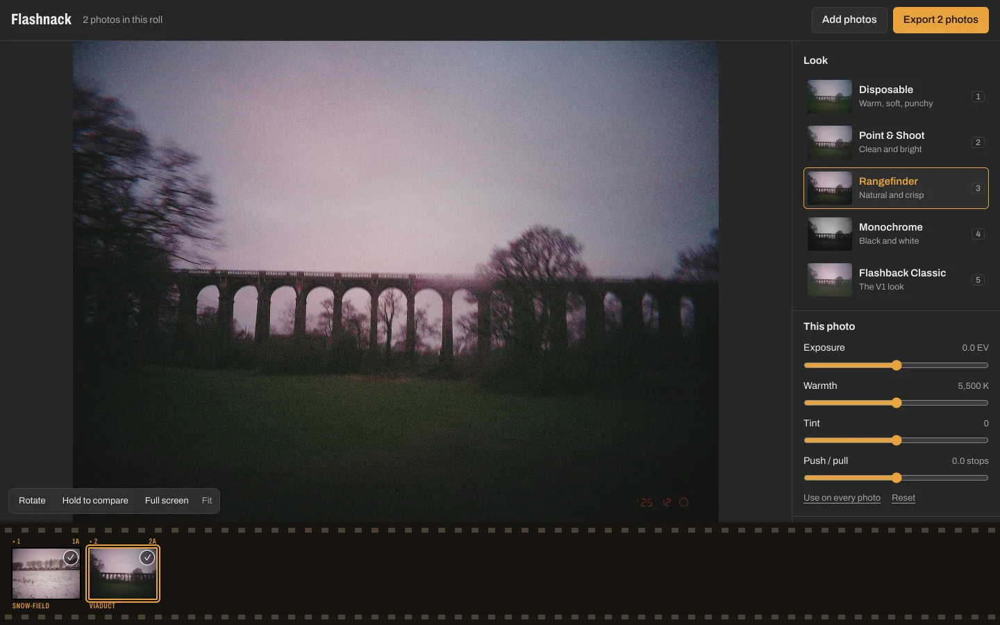
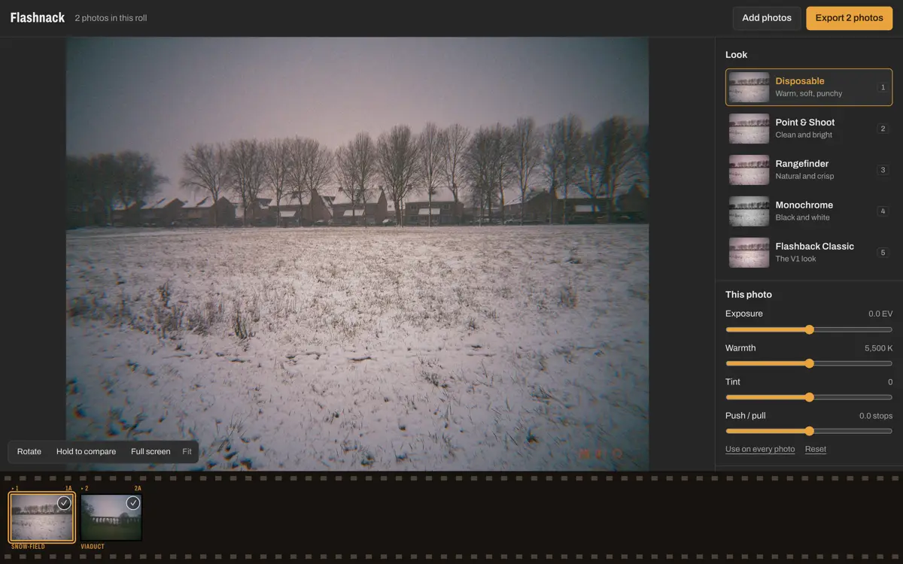
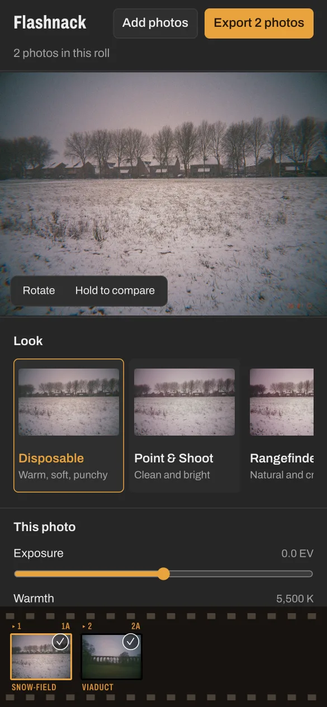

<div align="center">

# Flashnack

Develop your Flashback ONE35 photos in the browser. Drop a roll, pick a film look, export.

[Try it](https://gitguy268.github.io/flashnack/) · [How it works](#how-it-works) · [Run it locally](#run-it-locally-step-by-step) · [Controls](#controls) · [Contributing](CONTRIBUTING.md)




</div>

Flashnack is a web version of [LoFi Logic](https://github.com/lofilogic/flashback-raw-editor), the desktop RAW editor for the [Flashback](https://joinflashback.co) ONE35 camera. It uses the same colour pipeline, the same five film looks and the same effects (halation, bloom, grain, softness, vignette), ported to WebGPU so it runs in a browser tab. There's nothing to install and no account. Your photos are never uploaded: everything happens on your device.



<!-- live-links -->
**Live:** [gitguy268.github.io/flashnack](https://gitguy268.github.io/flashnack/)
<!-- /live-links -->

## Three steps

1. **Drop your photos** on the page, or click **Choose photos**. A whole folder works too.
2. **Pick a look.** Each card shows your photo in that look. Press `1` to `5` to switch.
3. **Export.** You get a zip of full-quality JPEGs. Click the tick on a frame in the film strip to leave a dud out.

Exposure, warmth and tint are per photo. **Use on every photo** copies them to the whole roll. **Fine-tune the look** has the film effects, and changes there apply to every photo in that look.

## What it opens

| Camera | File | How well |
|---|---|---|
| Flashback ONE35 V2 | `.dng` straight from the camera | The main target. Camera-matched colour, identical to LoFi Logic |
| Flashback ONE35 V1 | the negatives `.zip` from the Flashback app | Same colour matrix as LoFi Logic; Flashnack's own demosaic, so close but not identical (checked on a synthetic negative, not on a real V1 roll yet) |
| Other cameras | Canon, Nikon, Sony, Fujifilm and other RAWs, other DNGs | Best effort, through LibRaw, as in LoFi Logic. Colour is not calibrated per camera. Tested on one Sony ARW; lossy Apple ProRAW DNGs don't open |
| Any camera | `.jpg`, `.png` | Experimental, as in LoFi Logic. The look goes on top of the camera's own processing |

<details>
<summary><b>Getting the photos off the camera</b></summary>

**ONE35 V2:** plug the camera in over USB **before** you develop the roll in the Flashback app, and open the DNG files on it. Developing in the app first clears the DNGs off the camera.

**ONE35 V1:** develop the roll in the Flashback app, then in the gallery choose **Share → Export negatives**. Drop the `.zip` you get on Flashnack.

Flashback app: [iOS](https://apps.apple.com/app/flashback-camera/id1601362087) · [Android](https://play.google.com/store/apps/details?id=co.joinflashback.android)
</details>

<!-- run-steps:start -->
## Run it locally, step by step

1. **Install [Node.js](https://nodejs.org) 20** or newer.

2. **Get the code:**

   ```sh
   git clone https://github.com/Gitguy268/flashnack.git
   cd flashnack
   ```

3. **Install and build:**

   ```sh
   npm ci
   npm run build
   ```

   On a Mac you can double-click `start.command` instead of steps 3 to 5.

4. **Start it:**

   ```sh
   npx vite preview --port 5292
   ```

5. **Open <http://localhost:5292/>** in your browser. Press `Ctrl+C` to stop.
<!-- run-steps:end -->

Opening `index.html` straight from the folder doesn't work, because browsers block the app's workers on `file://` pages. The page says so and points you to `start.command`.

## Controls

| Input | Action |
|---|---|
| `1` to `5` | Pick a look |
| `←` / `→` | Previous / next photo |
| Hold `Space`, or hold **Hold to compare** | See the photo without the look |
| `R` | Rotate 90° |
| Scroll, double-click | Zoom, fit / 100% |
| Drag (when zoomed) | Pan |
| `Cmd`/`Ctrl` + `C`, then `V` | Copy this photo's settings, paste on another |
| Double-click a slider | Reset it |
| `Z` | Full screen ("zen mode") |

In full screen, drag up or down for exposure, left or right for warmth and right-drag for tint. The arrow keys move between photos (`↑`/`↓` rotate), and `Esc` leaves.

<details>
<summary><b>Phones</b></summary>

Flashnack works at phone width: the looks scroll sideways and the film strip stays at the bottom. Use **Choose photos** to pick files. Phones with WebGPU render on the GPU; others use the slower CPU renderer. Only phone-sized desktop browsers have been tested so far, not real phones.


</details>

## How it works

Every photo is developed once into a linear [ACEScg](https://acescentral.com) image at half size (2072 px on the long edge for a V2 DNG), with halation baked in. Every slider move then renders that image again on the GPU:

```
DNG (10-bit RGGB)  ->  2x2 bin  ->  highlight recovery  ->  ForwardMatrix  ->  ACEScg  (+ halation)
ACEScg  ->  exposure · white balance · tint · push/pull
        ->  vignette -> bloom -> chroma noise reduction        (linear light)
        ->  ACEScct -> 65³ 3D LUT, tetrahedral                  (the look)
        ->  colour fringing -> softness -> grain -> sharpen     (display)
        ->  JPEG
```

The decode runs in a Web Worker. The render runs in WebGPU compute shaders, ported unchanged from LoFi Logic's WGSL. In browsers without WebGPU the same stages run in JavaScript, in a second worker. That is slower, so the preview shows a half-size draft while you drag and the full render once you stop.

<details>
<summary><b>Checked against the desktop app</b></summary>

The port is tested pixel for pixel against LoFi Logic's own code (`core.processor`, its GPU path, grain off) on four ONE35 V2 DNGs:

| Stage | Largest difference (0 to 1 scale) |
|---|---|
| Raw unpack | 0, bit-exact with rawpy |
| Half-size binning | 0, bit-exact with rawpy |
| Develop with halation | 7 × 10⁻⁷ |
| Final render, all five looks, WebGPU | 1 × 10⁻⁵ |
| Final render, CPU renderer (2 DNGs) | 2 × 10⁻⁴ |
| V1 negative develop (synthetic negative) | mean 2 × 10⁻³, sharp edges up to 0.2 (different demosaic) |
| Sony ARW through LibRaw, Disposable look | mean 4 × 10⁻³ on the exported JPEG |

One 8-bit level is 4 × 10⁻³, so for V2 DNGs the rendered pixels are the desktop app's. The JPEG files themselves differ slightly, because Flashnack encodes with MozJPEG and the desktop app with Pillow. Grain is the exception: both apps place the same grain tiles at random, so grain differs between any two exports. CONTRIBUTING.md has the steps to rerun the check.
</details>

<details>
<summary><b>What the desktop app has and Flashnack doesn't</b></summary>

- **USB import from the camera.** Browsers can't talk to the camera; open the files from it instead.
- **DNG export**, the F12 LUT-profiling panel, reverse auto-exposure and `.lofi` project files.
- **Your own `.cube` LUTs.**
- **Auto tint** (the WB-linked tint toggle).

Settings you change in **Fine-tune the look** and the look you picked are remembered in this browser. Photos and per-photo settings are not: reloading the page starts an empty roll.
</details>

## Licence and credits

Flashnack is [GPL-3.0](LICENSE), the same licence as LoFi Logic, which it is ported from. The colour pipeline, shaders, LUTs, grain textures and look settings come from [lofilogic/flashback-raw-editor](https://github.com/lofilogic/flashback-raw-editor), and each ported file names its source. [NOTICE](NOTICE) lists everything, with the bundled libraries: fflate (MIT), @jsquash/jpeg with MozJPEG (Apache-2.0), libraw-wasm with LibRaw (ISC, LGPL-2.1/CDDL) and the Archivo font (OFL-1.1).

Flashnack is an independent project. It is not made by or affiliated with LoFi Logic or Flashback.
